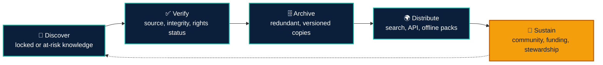
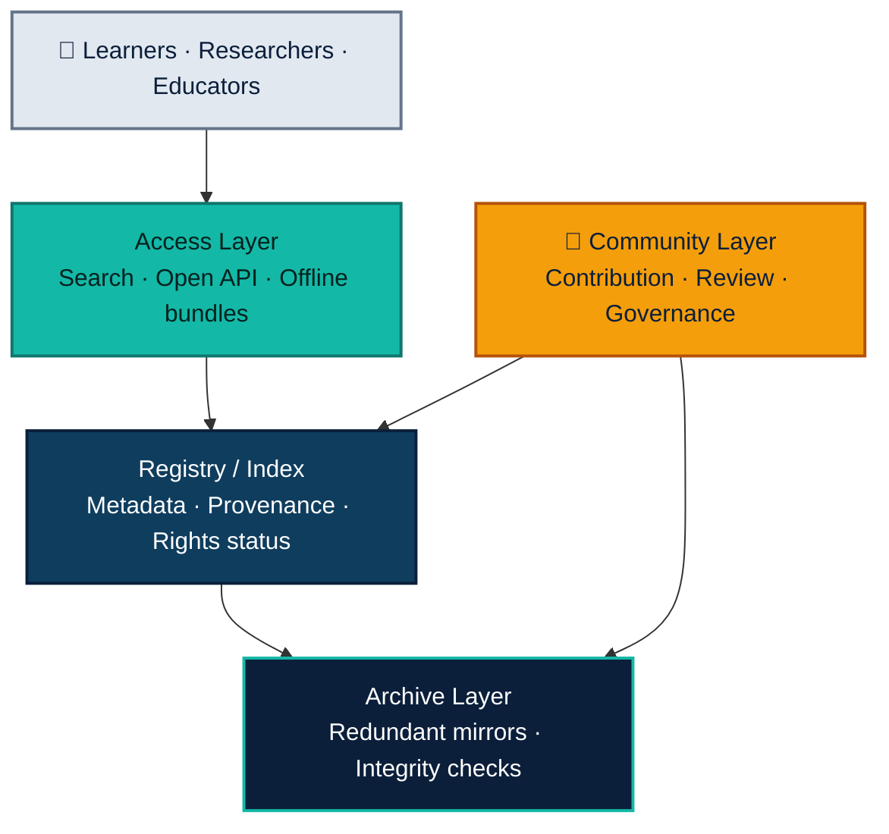

 

 

**[Problem](#1-the-problem)** &nbsp;·&nbsp;
**[Causes](#2-root-causes)** &nbsp;·&nbsp;
**[Impact](#3-impact)** &nbsp;·&nbsp;
**[Principles](#4-vision-and-principles)** &nbsp;·&nbsp;
**[Solution](#5-the-solution)** &nbsp;·&nbsp;
**[Stack](#8-technology-stack)** &nbsp;·&nbsp;
**[Roadmap](#9-roadmap)** &nbsp;·&nbsp;
**[Contribute](#13-how-to-contribute)**

---

> [!NOTE]
> **Executive Summary.** Humanity's scientific, educational, and historical knowledge is increasingly either *locked* behind paywalls and access barriers, or *lost* through deletion and neglect. **Open Knowledge Commons** is a global framework to unlock access to this knowledge and preserve it for future generations, so that anyone who wishes to learn can do so, and so that documented mistakes are not repeated.

---

## 1. The Problem

Humanity produces an immense body of knowledge: scientific studies, educational material, historical records, and practical expertise. A large share of it is either:

| | Condition | Description |
|:---:|---|---|
| 🔒 | **Locked** | Placed behind paywalls, subscriptions, institutional logins, or restrictive platforms. |
| 🕳️ | **Lost** | Deleted, abandoned, taken offline, or left to decay when a person, company, or project disappears. |

As a result, anyone who wants to learn eventually meets a wall, and valuable lessons, including documented failures and errors, vanish and are repeated.

## 2. Root Causes

| Cause | Description |
|---|---|
| **Economic gatekeeping** | Access depends on the ability to pay or on affiliation with a well-funded institution. |
| **Fragile hosting** | Knowledge lives on single servers, personal accounts, or corporate platforms that can shut down. |
| **Link rot and content drift** | Pages move, change, or disappear without leaving a trace. |
| **Misaligned incentives** | Creators are rewarded for restricting content, not for sharing or archiving it. |
| **Fragmentation** | Open and archived material exists, but it is scattered and difficult to find. |
| **Absence of stewardship** | When creators stop maintaining their work, nobody is responsible for keeping it alive. |

## 3. Impact

- **Learners and self-taught people** are blocked from primary sources.
- **Researchers in low-resource regions** cannot build on existing work.
- **Society repeats documented mistakes** because the evidence is inaccessible or gone.
- **Historical memory erodes**, weakening our ability to verify claims and hold power accountable.
- **Inequality in knowledge** widens the gap between those who can pay and those who cannot.

## 4. Vision and Principles

> [!IMPORTANT]
> **Vision.** A world where any person, anywhere, can find, read, and rely on humanity's knowledge, and where that knowledge outlives its original publisher.

| # | Principle | Meaning |
|:---:|---|---|
| 1 | **Access for all** | Curiosity should not require a budget. |
| 2 | **Preserve by default** | Important knowledge should have more than one copy, in more than one place. |
| 3 | **Decentralized resilience** | No single point of failure, owner, or censor. |
| 4 | **Transparency and verifiability** | Every item keeps its provenance: source, date, version, and integrity checks. |
| 5 | **Community-driven** | Built and maintained by contributors, not gatekept by a few. |
| 6 | **Respect for people** | Privacy, consent, and safety are designed in from the start. |

## 5. The Solution

The framework rests on **two pillars** and one **enabling layer**.

<table>
<tr>
<td width="50%" valign="top">

<h3>🔓 Pillar A: Unlock (Access)</h3>

<b>Make existing knowledge easier to reach.</b>
<ul>
<li><b>Open-version discovery.</b> A unified search that finds legally available open copies of paywalled work: preprints, author-deposited versions, institutional repositories, and public-domain editions.</li>
<li><b>Open deposit tools.</b> Simple tools that help authors and institutions publish open copies of their work.</li>
<li><b>Plain-language access layers.</b> Summaries, translations, and learning paths, so access means understanding, not just availability.</li>
<li><b>Offline and low-bandwidth packs.</b> Downloadable collections for regions with limited connectivity.</li>
</ul>

</td>
<td width="50%" valign="top">

<h3>🏛️ Pillar B: Preserve (Archive)</h3>

<b>Ensure knowledge survives its creators and platforms.</b>
<ul>
<li><b>Redundant archiving.</b> Multiple mirrors across institutions, countries, and storage systems.</li>
<li><b>Integrity and provenance.</b> Cryptographic hashes and versioned records so copies can be verified and traced to their source.</li>
<li><b>At-risk triage.</b> Prioritize endangered content: abandoned projects, defunct sites, and datasets at risk of losing funding.</li>
<li><b>Open, durable formats.</b> Prefer non-proprietary formats that remain readable for decades.</li>
<li><b>Lessons-learned collections.</b> Curated sets of failures, retractions, post-mortems, and negative results, studied rather than repeated.</li>
</ul>

</td>
</tr>
</table>

### Enabling Layer: Community and Incentives

| | Element | Description |
|:---:|---|---|
| 👥 | **Contributor roles** | Archivists, curators, translators, verifiers, developers, and institutional partners. |
| 🏅 | **Recognition** | Visible credit, contribution history, and reputation for those who save and share knowledge. |
| 🤝 | **Creator pledge** | An opt-in commitment where creators agree to deposit an open or archived copy of their work. |
| 🏫 | **Institutional partnerships** | Universities, libraries, museums, and NGOs as long-term custodians. |

## 6. How It Works

## 7. High-Level Architecture

| Layer | Purpose |
|---|---|
| **Registry / Index** | A public catalog of items with metadata, provenance, rights status, and the locations of all copies. |
| **Archive Layer** | Distributed storage with multiple mirrors and automated integrity verification. |
| **Access Layer** | Search, open API, offline bundles, and learner-friendly interfaces. |
| **Community Layer** | Contribution workflows, peer review, moderation, and governance. |

*Design preference: open standards, open-source code, and federated or decentralized hosting where practical.*

## 8. Technology Stack

> [!NOTE]
> This is the **proposed** stack for the initial phases. Every component is open source or built on open standards, in line with the project's principles of resilience and no vendor lock-in. Choices may evolve as the community grows.

### Core Components

| Layer | Technology | Role |
|---|---|---|
| **Frontend** | TypeScript · Next.js · Tailwind CSS | Accessible, fast, low-bandwidth interface for search and reading. |
| **Backend / API** | Python · FastAPI | Open, documented REST API (OpenAPI) and ingestion services. |
| **Registry database** | PostgreSQL | Metadata, provenance, versions, and rights status for every item. |
| **Search** | Meilisearch (MVP) → OpenSearch (scale) | Fast full-text and faceted search across the catalog. |
| **Archive storage** | IPFS · S3-compatible storage (MinIO) | Content-addressed, redundant, verifiable copies across multiple mirrors. |
| **Web archiving** | Browsertrix Crawler · ArchiveBox | Capturing and preserving at-risk web pages and sites. |
| **Background jobs** | Celery · Redis | Crawling, hashing, format conversion, and periodic integrity re-checks. |
| **Offline access** | Kiwix (ZIM format) | Downloadable collections for low-connectivity regions. |
| **Infrastructure** | Docker · GitHub Actions | Reproducible environments and automated testing and deployment. |
| **Documentation** | MkDocs Material | Public documentation for contributors and API users. |
| **Community** | GitHub Issues and Discussions · Matrix | Open collaboration and governance discussion. |

### Standards and Formats

| Standard | Use |
|---|---|
| **WARC** | Container format for archived web content. |
| **PDF/A** | Long-term preservation of documents. |
| **SHA-256 and content identifiers (CIDs)** | Integrity verification and content addressing. |
| **Dublin Core · DataCite · schema.org** | Interoperable metadata. |
| **OAI-PMH** | Harvesting records from institutional repositories. |
| **BagIt** | Packaging archived items together with checksums. |

### Data Sources and Integrations

| Source | Purpose |
|---|---|
| **OpenAlex** | Open catalog of scholarly works and metadata. |
| **Unpaywall API** | Discovery of legal open-access versions of papers. |
| **Crossref API** | DOI and publication metadata. |
| **Internet Archive APIs** | Existing web captures and cross-mirroring. |

### Selection Criteria

- **Open source first.** Prefer tools anyone can inspect, run, and fork.
- **Open standards.** Favor formats that outlive any single vendor.
- **No single point of failure.** Every critical component must be replaceable.
- **Low-bandwidth friendly.** Performance and accessibility on modest connections and devices.
- **Contributor-friendly.** Widely known technologies, so more people can help.

## 9. Roadmap

| Phase | Focus | Key Outcomes |
|:---:|---|---|
| **0** | **Foundation** | Define scope, name, and governance model. Publish this framework and gather feedback. Map existing initiatives and identify genuine gaps. |
| **1** | **Minimum Viable Project** | Basic registry and search for open versions of existing work. A small curated archive in one domain (e.g., science or history). First contributors and partner institutions. |
| **2** | **Growth** | Redundant mirrors and automated integrity checks. At-risk monitoring and rescue workflows. Translations, summaries, and offline packs. |
| **3** | **Global Scale** | Multi-language, multi-region coverage. Formal partnerships with libraries, universities, and NGOs. Sustainable governance and funding model. |

## 10. Measuring Success

| Indicator | What It Tells Us |
|---|---|
| Items preserved with verified, redundant copies | Depth and reliability of the archive. |
| Share of at-risk content rescued before loss | Effectiveness of triage. |
| Learners and regions reached, including low-resource areas | Real-world access impact. |
| Time and cost for a learner to find an open version of a work | Usability of the access layer. |
| Active contributors and partner institutions | Health of the community. |
| Languages supported | Global inclusiveness. |

## 11. Existing Landscape and the Gap

This project does not begin from zero. Significant work already exists:

| Initiative | Contribution |
|---|---|
| **Internet Archive / Wayback Machine** | Web and media preservation. |
| **arXiv, Zenodo, institutional repositories** | Open research deposits. |
| **Unpaywall and similar tools** | Discovery of legal open copies. |
| **Wikipedia / Wikimedia** | Open, community-built knowledge. |
| **Project Gutenberg** | Public-domain books. |
| **Creative Commons** | Licensing frameworks for sharing. |
| **Software Heritage** | Preservation of source code. |

> [!TIP]
> **The gap this framework targets.** These efforts are powerful but fragmented. There is room for a **unified, community-governed layer** that connects discovery, preservation, and learner-friendly access across all domains, with a particular focus on at-risk content and documented failures.

## 12. Open Questions and Risks

> [!WARNING]
> The following topics are intentionally left open at this sketch stage and must be resolved before implementation.

| Topic | Question |
|---|---|
| **Copyright and licensing** | Which content can be legally mirrored, and what is the policy for restricted material? How do creators and publishers remain sustainable? |
| **Privacy** | How are legitimate removal requests and the right to be forgotten handled? |
| **Quality and misinformation** | Preservation is not endorsement; how are retracted or false materials labeled? |
| **Governance** | Who decides, and how are decisions made transparently? |
| **Funding** | How is long-term storage and maintenance financed? |
| **Legal risk** | How are differing rules across jurisdictions managed? |

## 13. How to Contribute

This is an open idea, and it improves with scrutiny. You can help by:

- Opening an **issue** with feedback, critiques, or related projects.
- Proposing **improvements** to this framework through a pull request.
- Sharing **expertise** in archiving, law, research, education, or software.
- **Spreading the word** to people who might want to build this.

## 14. License

Suggested: **CC BY-SA 4.0** for this document, and an OSI-approved open-source license (for example, MIT or Apache-2.0) for any code that follows.

---

**Knowledge belongs to everyone who seeks it.**

## 12. Market Opportunity: TAM, SAM and SOM

### Market Sizing Methodology

Open Knowledge Commons operates at the intersection of open knowledge discovery, digital preservation, research infrastructure, and educational access. Its potential audience includes students, independent learners, researchers, educators, librarians, and institutions responsible for preserving knowledge.

The market is assessed through three levels:

- **TAM (Total Addressable Market):** The broadest potential audience for the platform's mission and services.
- **SAM (Serviceable Available Market):** The portion of that audience the initial platform can realistically serve through its language support, technology, and distribution channels.
- **SOM (Serviceable Obtainable Market):** The portion of the SAM the project could realistically reach and engage during its first three years.

> **Important distinction:** These figures describe potential users, not paying customers or guaranteed revenue. Open Knowledge Commons is an open-access initiative, and its financial sustainability would depend on voluntary donations, grants, institutional partnerships, sponsorships, or optional value-added services.

### 12.1 Total Addressable Market (TAM)

**Scope:** Global internet-connected learners, researchers, educators, and other people seeking scientific, educational, historical, and practical knowledge.

The International Telecommunication Union estimated that approximately 6 billion people were using the internet in 2025. This provides a broad indicator of the potential digital reach of a global knowledge-access initiative.

However, not every internet user needs or would use this platform. Therefore, the global online population should be treated as an upper-bound reference rather than the project's actual addressable audience.

**Initial planning estimate:** 100 million–500 million potential users worldwide, subject to validation through audience research and existing platform usage data.

**Value proposition:** Make knowledge easier to discover, understand, verify, and preserve, regardless of a user's location or institutional affiliation.

### 12.2 Serviceable Available Market (SAM)

**Scope:** Digitally connected students, self-taught learners, independent researchers, educators, and open-knowledge contributors who actively seek reliable resources and can be reached through the project's initial languages and online distribution channels.

The initial serviceable audience would prioritize English- and Spanish-speaking users, with particular attention to students, people learning independently, and communities with limited access to institutional resources.

**Initial planning estimate:** 1 million–10 million potential users.

This estimate represents a hypothesis to validate, not a measured count of people currently seeking this exact solution. Future research should narrow the segment using surveys, search-demand analysis, existing platform data, and interviews with educational institutions.

### 12.3 Serviceable Obtainable Market (SOM)

**Scope:** The subset of the initial target audience that Open Knowledge Commons could realistically attract, activate, and retain during its first three years.

The initial acquisition strategy would focus on:

- Open-source and knowledge-sharing communities.
- Student and researcher communities.
- Partnerships with schools, universities, libraries, and educational organizations.
- Educational content, community contributions, and organic search.
- Contributors interested in digital preservation and open access.

**Three-year planning target:** 1,000–10,000 registered users, with retention, active participation, and the number of successfully preserved resources tracked as separate indicators.

This target is a scenario for planning purposes, not a forecast based on existing traction.

### 12.4 Market Sizing Summary

| Market | Definition | Preliminary estimate |
|---|---|---:|
| TAM | Potential global audience | 100M–500M users |
| SAM | Reachable initial audience | 1M–10M users |
| SOM | Three-year acquisition target | 1K–10K registered users |

The estimates will be refined as the project establishes its initial domain, validates user demand, measures adoption, and identifies institutional partners.

### 12.5 Sustainability and Funding Opportunity

Open Knowledge Commons should distinguish between the size of its social impact opportunity and its revenue opportunity.

The platform's core mission is to preserve and improve access to knowledge. Access to legally available public resources should remain consistent with the project's open-access principles.

Potential funding sources include:

- Research and digital-preservation grants.
- Donations from individuals and philanthropic organizations.
- Institutional partnerships with universities, libraries, and museums.
- Sponsorships aligned with the project's mission.
- Optional institutional tools, preservation services, or managed infrastructure.

Revenue estimates should only be developed after validating the funding model, willingness to pay, operating costs, and the number of prospective institutional partners.

### 12.6 Validation Plan

Before treating these estimates as established market figures, the project should:

1. Define its initial content domain and primary user segment.
2. Analyze comparable platforms and the audiences they serve.
3. Interview at least 20 prospective users and 5 potential institutional partners.
4. Launch a landing page to measure qualified interest and sign-ups.
5. Track activation, repeat usage, successful resource discovery, and contributions.
6. Revise the TAM, SAM, and SOM assumptions using observed data.

**Reference:** International Telecommunication Union (ITU), *Facts and Figures 2025*. https://www.itu.int/en/ITU-D/Statistics/Pages/facts/default.aspx
