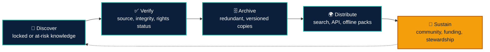
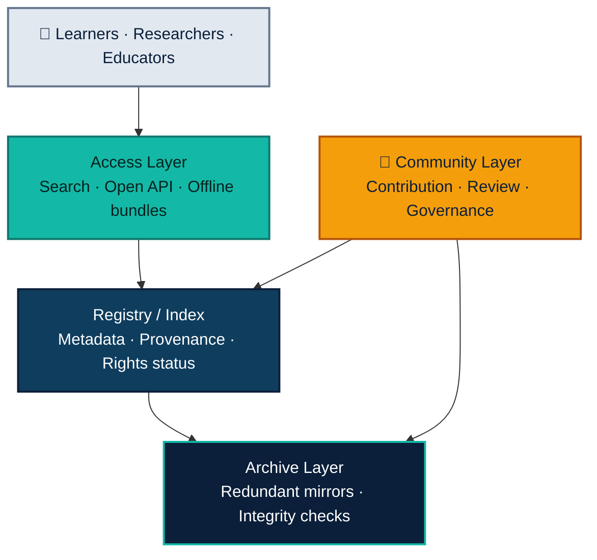

 

 

**[Problem](#1-the-problem)** &nbsp;·&nbsp;
**[Causes](#2-root-causes)** &nbsp;·&nbsp;
**[Impact](#3-impact)** &nbsp;·&nbsp;
**[Principles](#4-vision-and-principles)** &nbsp;·&nbsp;
**[Solution](#5-the-solution)** &nbsp;·&nbsp;
**[Roadmap](#8-roadmap)** &nbsp;·&nbsp;
**[Contribute](#12-how-to-contribute)**

---

> [!NOTE]
> **Executive Summary.** Humanity's scientific, educational, and historical knowledge is increasingly either *locked* behind paywalls and access barriers, or *lost* through deletion and neglect. **Open Knowledge Commons** is a global framework to unlock access to this knowledge and preserve it for future generations, so that anyone who wishes to learn can do so, and so that documented mistakes are not repeated.

---

## 1. The Problem

Humanity produces an immense body of knowledge: scientific studies, educational material, historical records, and practical expertise. A large share of it is either:

| | Condition | Description |
|:---:|---|---|
| 🔒 | **Locked** | Placed behind paywalls, subscriptions, institutional logins, or restrictive platforms. |
| 🕳️ | **Lost** | Deleted, abandoned, taken offline, or left to decay when a person, company, or project disappears. |

As a result, anyone who wants to learn eventually meets a wall, and valuable lessons, including documented failures and errors, vanish and are repeated.

## 2. Root Causes

| Cause | Description |
|---|---|
| **Economic gatekeeping** | Access depends on the ability to pay or on affiliation with a well-funded institution. |
| **Fragile hosting** | Knowledge lives on single servers, personal accounts, or corporate platforms that can shut down. |
| **Link rot and content drift** | Pages move, change, or disappear without leaving a trace. |
| **Misaligned incentives** | Creators are rewarded for restricting content, not for sharing or archiving it. |
| **Fragmentation** | Open and archived material exists, but it is scattered and difficult to find. |
| **Absence of stewardship** | When creators stop maintaining their work, nobody is responsible for keeping it alive. |

## 3. Impact

- **Learners and self-taught people** are blocked from primary sources.
- **Researchers in low-resource regions** cannot build on existing work.
- **Society repeats documented mistakes** because the evidence is inaccessible or gone.
- **Historical memory erodes**, weakening our ability to verify claims and hold power accountable.
- **Inequality in knowledge** widens the gap between those who can pay and those who cannot.

## 4. Vision and Principles

> [!IMPORTANT]
> **Vision.** A world where any person, anywhere, can find, read, and rely on humanity's knowledge, and where that knowledge outlives its original publisher.

| # | Principle | Meaning |
|:---:|---|---|
| 1 | **Access for all** | Curiosity should not require a budget. |
| 2 | **Preserve by default** | Important knowledge should have more than one copy, in more than one place. |
| 3 | **Decentralized resilience** | No single point of failure, owner, or censor. |
| 4 | **Transparency and verifiability** | Every item keeps its provenance: source, date, version, and integrity checks. |
| 5 | **Community-driven** | Built and maintained by contributors, not gatekept by a few. |
| 6 | **Respect for people** | Privacy, consent, and safety are designed in from the start. |

## 5. The Solution

The framework rests on **two pillars** and one **enabling layer**.

<table>
<tr>
<td width="50%" valign="top">

<h3>🔓 Pillar A: Unlock (Access)</h3>

<b>Make existing knowledge easier to reach.</b>
<ul>
<li><b>Open-version discovery.</b> A unified search that finds legally available open copies of paywalled work: preprints, author-deposited versions, institutional repositories, and public-domain editions.</li>
<li><b>Open deposit tools.</b> Simple tools that help authors and institutions publish open copies of their work.</li>
<li><b>Plain-language access layers.</b> Summaries, translations, and learning paths, so access means understanding, not just availability.</li>
<li><b>Offline and low-bandwidth packs.</b> Downloadable collections for regions with limited connectivity.</li>
</ul>

</td>
<td width="50%" valign="top">

<h3>🏛️ Pillar B: Preserve (Archive)</h3>

<b>Ensure knowledge survives its creators and platforms.</b>
<ul>
<li><b>Redundant archiving.</b> Multiple mirrors across institutions, countries, and storage systems.</li>
<li><b>Integrity and provenance.</b> Cryptographic hashes and versioned records so copies can be verified and traced to their source.</li>
<li><b>At-risk triage.</b> Prioritize endangered content: abandoned projects, defunct sites, and datasets at risk of losing funding.</li>
<li><b>Open, durable formats.</b> Prefer non-proprietary formats that remain readable for decades.</li>
<li><b>Lessons-learned collections.</b> Curated sets of failures, retractions, post-mortems, and negative results, studied rather than repeated.</li>
</ul>

</td>
</tr>
</table>

### Enabling Layer: Community and Incentives

| | Element | Description |
|:---:|---|---|
| 👥 | **Contributor roles** | Archivists, curators, translators, verifiers, developers, and institutional partners. |
| 🏅 | **Recognition** | Visible credit, contribution history, and reputation for those who save and share knowledge. |
| 🤝 | **Creator pledge** | An opt-in commitment where creators agree to deposit an open or archived copy of their work. |
| 🏫 | **Institutional partnerships** | Universities, libraries, museums, and NGOs as long-term custodians. |

## 6. How It Works

## 7. High-Level Architecture

| Layer | Purpose |
|---|---|
| **Registry / Index** | A public catalog of items with metadata, provenance, rights status, and the locations of all copies. |
| **Archive Layer** | Distributed storage with multiple mirrors and automated integrity verification. |
| **Access Layer** | Search, open API, offline bundles, and learner-friendly interfaces. |
| **Community Layer** | Contribution workflows, peer review, moderation, and governance. |

*Design preference: open standards, open-source code, and federated or decentralized hosting where practical.*

## 8. Roadmap

| Phase | Focus | Key Outcomes |
|:---:|---|---|
| **0** | **Foundation** | Define scope, name, and governance model. Publish this framework and gather feedback. Map existing initiatives and identify genuine gaps. |
| **1** | **Minimum Viable Project** | Basic registry and search for open versions of existing work. A small curated archive in one domain (e.g., science or history). First contributors and partner institutions. |
| **2** | **Growth** | Redundant mirrors and automated integrity checks. At-risk monitoring and rescue workflows. Translations, summaries, and offline packs. |
| **3** | **Global Scale** | Multi-language, multi-region coverage. Formal partnerships with libraries, universities, and NGOs. Sustainable governance and funding model. |

## 9. Measuring Success

| Indicator | What It Tells Us |
|---|---|
| Items preserved with verified, redundant copies | Depth and reliability of the archive. |
| Share of at-risk content rescued before loss | Effectiveness of triage. |
| Learners and regions reached, including low-resource areas | Real-world access impact. |
| Time and cost for a learner to find an open version of a work | Usability of the access layer. |
| Active contributors and partner institutions | Health of the community. |
| Languages supported | Global inclusiveness. |

## 10. Existing Landscape and the Gap

This project does not begin from zero. Significant work already exists:

| Initiative | Contribution |
|---|---|
| **Internet Archive / Wayback Machine** | Web and media preservation. |
| **arXiv, Zenodo, institutional repositories** | Open research deposits. |
| **Unpaywall and similar tools** | Discovery of legal open copies. |
| **Wikipedia / Wikimedia** | Open, community-built knowledge. |
| **Project Gutenberg** | Public-domain books. |
| **Creative Commons** | Licensing frameworks for sharing. |
| **Software Heritage** | Preservation of source code. |

> [!TIP]
> **The gap this framework targets.** These efforts are powerful but fragmented. There is room for a **unified, community-governed layer** that connects discovery, preservation, and learner-friendly access across all domains, with a particular focus on at-risk content and documented failures.

## 11. Open Questions and Risks

> [!WARNING]
> The following topics are intentionally left open at this sketch stage and must be resolved before implementation.

| Topic | Question |
|---|---|
| **Copyright and licensing** | Which content can be legally mirrored, and what is the policy for restricted material? How do creators and publishers remain sustainable? |
| **Privacy** | How are legitimate removal requests and the right to be forgotten handled? |
| **Quality and misinformation** | Preservation is not endorsement; how are retracted or false materials labeled? |
| **Governance** | Who decides, and how are decisions made transparently? |
| **Funding** | How is long-term storage and maintenance financed? |
| **Legal risk** | How are differing rules across jurisdictions managed? |

## 12. How to Contribute

This is an open idea, and it improves with scrutiny. You can help by:

- Opening an **issue** with feedback, critiques, or related projects.
- Proposing **improvements** to this framework through a pull request.
- Sharing **expertise** in archiving, law, research, education, or software.
- **Spreading the word** to people who might want to build this.

## 13. License

Suggested: **CC BY-SA 4.0** for this document, and an OSI-approved open-source license (for example, MIT or Apache-2.0) for any code that follows.

---

**Knowledge belongs to everyone who seeks it.**

